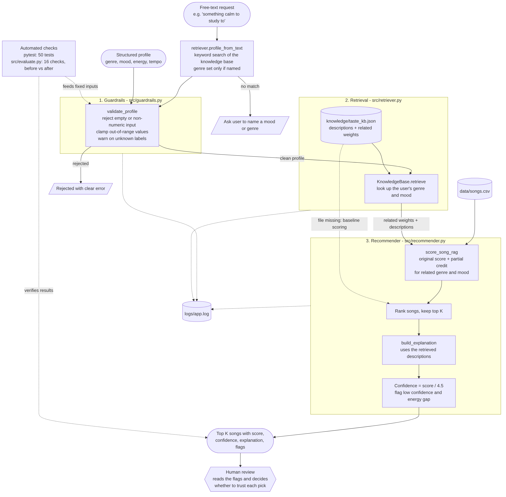

# VibeFinder 2.0: A Retrieval-Augmented Music Recommender

VibeFinder 2.0 is a music recommender that looks up what a listener's mood and genre *mean* in a small knowledge base before it ranks songs. It runs entirely offline, explains every pick in plain language, rates its own confidence, and refuses or flags input it cannot trust.

## Original Project

**Base project: Music Recommender Simulation ("VibeFinder 1.0"), Module 3.** VibeFinder 1.0 was a small content-based recommender. It loaded an 18-song catalog, compared each song to a listener's favorite genre, mood, energy, and tempo, and returned the top 5 songs with a reason for each score. Its model card documented a key weakness: genre and mood were exact-match labels, so "chill" and "relaxed" counted as a total miss. This project extends that system and keeps the original scoring intact as a baseline. 

## Title and Summary

**What it does.** Given a listener profile (favorite genre, mood, target energy, target tempo) or a plain-English request such as *"something calm to study to"*, VibeFinder 2.0:

1. **Validates** the input (rejects empty or non-numeric profiles, clamps out-of-range values, warns about unknown labels).
2. **Retrieves** the knowledge base entries for the listener's genre and mood, including which other moods and genres are *related* and how strongly.
3. **Scores** every song with the original VibeFinder 1.0 rules plus partial credit for related genres and moods.
4. **Explains** each recommendation using the retrieved descriptions, and attaches a **confidence score** and warning flags.

**Why it matters.** The retrieved knowledge changes the answer instead of decorating it: related-label credit changes the ranking for all four test profiles. That is the difference between a retrieval step that does real work and one that only prints extra text. Because retrieval and generation are both deterministic and offline (no API key, no network), every behavior in this README can be reproduced and tested.

**AI feature: Retrieval-Augmented Generation (RAG).** Retrieval reads `knowledge/taste_kb.json`; the retrieved weights drive the scores and the retrieved descriptions are used to write each explanation. Guardrails, logging, confidence scoring, and a test harness make the behavior measurable.

## Architecture Overview



The diagram source is [`diagrams/architecture.mmd`](diagrams/architecture.mmd) (Mermaid).

**Data flow:** a structured profile, or a free-text request that `profile_from_text` first converts into a profile, enters the **guardrails**. A clean profile goes to **retrieval**, which looks up the listener's genre and mood in the knowledge base. The **recommender** scores every song in `data/songs.csv` using the retrieved related-label weights, ranks them, writes an explanation from the retrieved descriptions, and attaches a confidence score and flags. The output goes to a **human**, who reads the flags and decides whether to trust each pick. Automated checks (`pytest` and `src/evaluate.py`) feed fixed inputs through the pipeline and verify the results. Every stage writes to `logs/app.log`.

**Failure paths:** invalid input is rejected with a clear message, a free-text request that matches nothing asks the user to name a mood or genre, and a missing or invalid knowledge base falls back to the original VibeFinder 1.0 scoring.

| Component | File | Job |
|---|---|---|
| Knowledge base | `knowledge/taste_kb.json` | Plain-English description of 13 moods and 15 genres, plus weighted lists of related moods and genres |
| Retriever | `src/retriever.py` | Looks up a profile's genre and mood; turns free-text requests into profiles with a small keyword search |
| Guardrails | `src/guardrails.py` | Validates input, clamps values, labels confidence as high, medium, or low |
| Recommender | `src/recommender.py` | Original scoring, retrieval-aware scoring, explanations, confidence and flags, and the `Recommender` class |
| CLI | `src/main.py` | Runs the pipeline; `--baseline` and `--ask` options |
| Evaluation harness | `src/evaluate.py` | 16 pass/fail checks plus a before-and-after ranking comparison |
| Tests | `tests/` | 50 `pytest` tests |

## Setup Instructions

No API key or account is needed. Developed and tested on Python 3.13.

**1. Clone and enter the repository**

```bash
git clone https://github.com/Kissa530/applied-ai-system-project.git
cd applied-ai-system-project
```

**2. Create and activate a virtual environment**

```powershell
# Windows PowerShell
python -m venv .venv
.\.venv\Scripts\Activate.ps1
```

```bash
# macOS, Linux, or Git Bash
python3 -m venv .venv
source .venv/bin/activate
```

**3. Install dependencies**

```bash
python -m pip install --upgrade pip
pip install -r requirements.txt
```

`requirements.txt` also lists `pandas` and `streamlit` from the original starter project; this project does not use them.

**4. Run it** (always from the repository root)

| Command | What it does |
|---|---|
| `python -m src.main` | Runs four listener profiles, two free-text requests, and four bad-input checks |
| `python -m src.main --baseline` | Runs the original VibeFinder 1.0 scoring, for comparison |
| `python -m src.main --ask "something calm to study to"` | Turns a plain-English request into a profile and recommends songs |
| `python -m pytest` | Runs the 50 tests (expect `50 passed`) |
| `python -m src.evaluate` | Runs the evaluation harness (expect `16/16 checks passed`) |

Use `python -m pytest` rather than bare `pytest`, so the project folder is on Python's import path. Logs are written to `logs/app.log`, which is ignored by git.

## Sample Interactions

All outputs below were produced by running the commands in this repository.

### Example 1: Structured profile through RAG

Command: `python -m src.main` (output trimmed to the Chill Lofi section)

Input profile: genre `lofi`, mood `chill`, target energy 0.40, target tempo 78 BPM.

```
Loaded songs: 18
Loaded knowledge base: 13 moods, 15 genres

=== Chill Lofi ===
  Genre: lofi
  Mood: chill
  Target energy: 0.40
  Target tempo: 78 BPM

Top recommendations:

1. Midnight Coding - LoRoom (Score: 4.48, Confidence: 1.00 high)
   Midnight Coding by LoRoom: its chill mood is the one you asked for (low-energy, unhurried music for studying, relaxing or winding down); it is lofi, your favorite genre (soft, slightly dusty beats made for studying and background listening); its energy (0.42) is close to your target (0.40).
   - genre match (+2.0)
   - mood match (+1.0)
   - energy closeness (+0.98)
   - tempo closeness (+0.50)

2. Library Rain - Paper Lanterns (Score: 4.42, Confidence: 0.98 high)
   Library Rain by Paper Lanterns: its chill mood is the one you asked for (low-energy, unhurried music for studying, relaxing or winding down); it is lofi, your favorite genre (soft, slightly dusty beats made for studying and background listening); its energy (0.35) is close to your target (0.40).
   - genre match (+2.0)
   - mood match (+1.0)
   - energy closeness (+0.95)
   - tempo closeness (+0.47)

3. Focus Flow - LoRoom (Score: 3.99, Confidence: 0.89 high)
   Focus Flow by LoRoom: its focused mood is a close relative of chill - you asked for chill: low-energy, unhurried music for studying, relaxing or winding down; it is lofi, your favorite genre (soft, slightly dusty beats made for studying and background listening); its energy (0.40) is close to your target (0.40).
   - genre match (+2.0)
   - energy closeness (+1.00)
   - tempo closeness (+0.49)
   - related mood: focused ~ chill (+0.50, retrieved weight 0.5)

4. Spacewalk Thoughts - Orbit Bloom (Score: 3.48, Confidence: 0.77 high)
   Spacewalk Thoughts by Orbit Bloom: its chill mood is the one you asked for (low-energy, unhurried music for studying, relaxing or winding down); ambient is closely related to your favorite genre, lofi; its energy (0.28) is close to your target (0.40).
   - mood match (+1.0)
   - energy closeness (+0.88)
   - tempo closeness (+0.40)
   - related genre: ambient ~ lofi (+1.20, retrieved weight 0.6)

5. Coffee Shop Stories - Slow Stereo (Score: 3.11, Confidence: 0.69 medium)
   Coffee Shop Stories by Slow Stereo: its relaxed mood is a close relative of chill - you asked for chill: low-energy, unhurried music for studying, relaxing or winding down; jazz is closely related to your favorite genre, lofi; its energy (0.37) is close to your target (0.40).
   - energy closeness (+0.97)
   - tempo closeness (+0.44)
   - related genre: jazz ~ lofi (+1.00, retrieved weight 0.5)
   - related mood: relaxed ~ chill (+0.70, retrieved weight 0.7)
```

**What to notice:**
- *Focus Flow* has no mood match, but retrieval lists `focused` as related to `chill` (weight 0.5), so it earns +0.50.
- *Spacewalk Thoughts* is ambient, not lofi, but retrieval lists `ambient` as related to `lofi` (weight 0.6), so it earns 2.0 × 0.6 = +1.20.
- *Coffee Shop Stories* (jazz, relaxed) enters the top 5 through two related-label credits. Under the original scoring it was not in the top 5.
- Each explanation quotes the retrieved description of the mood and genre.

### Example 2: Free-text request

Command: `python -m src.main --ask "something calm to study to"`

```
Loaded songs: 18
Loaded knowledge base: 13 moods, 15 genres

Request: 'something calm to study to'

=== Free-text request ===
  Genre: (any)
  Mood: chill
  Target energy: 0.40
  Target tempo: 78 BPM
  WARNING: favorite_genre missing; ranking uses mood, energy and tempo only

Top recommendations:

1. Midnight Coding - LoRoom (Score: 2.48, Confidence: 0.55 medium)
   Midnight Coding by LoRoom: its chill mood is the one you asked for (low-energy, unhurried music for studying, relaxing or winding down); its energy (0.42) is close to your target (0.40).
   - mood match (+1.0)
   - energy closeness (+0.98)
   - tempo closeness (+0.50)

2. Library Rain - Paper Lanterns (Score: 2.42, Confidence: 0.54 medium)
   Library Rain by Paper Lanterns: its chill mood is the one you asked for (low-energy, unhurried music for studying, relaxing or winding down); its energy (0.35) is close to your target (0.40).
   - mood match (+1.0)
   - energy closeness (+0.95)
   - tempo closeness (+0.47)

3. Spacewalk Thoughts - Orbit Bloom (Score: 2.28, Confidence: 0.51 medium)
   Spacewalk Thoughts by Orbit Bloom: its chill mood is the one you asked for (low-energy, unhurried music for studying, relaxing or winding down); its energy (0.28) is close to your target (0.40).
   - mood match (+1.0)
   - energy closeness (+0.88)
   - tempo closeness (+0.40)

4. Coffee Shop Stories - Slow Stereo (Score: 2.11, Confidence: 0.47 medium)
   Coffee Shop Stories by Slow Stereo: its relaxed mood is a close relative of chill - you asked for chill: low-energy, unhurried music for studying, relaxing or winding down; its energy (0.37) is close to your target (0.40).
   - energy closeness (+0.97)
   - tempo closeness (+0.44)
   - related mood: relaxed ~ chill (+0.70, retrieved weight 0.7)

5. Focus Flow - LoRoom (Score: 1.99, Confidence: 0.44 low)
   Focus Flow by LoRoom: its focused mood is a close relative of chill - you asked for chill: low-energy, unhurried music for studying, relaxing or winding down; its energy (0.40) is close to your target (0.40).
   - energy closeness (+1.00)
   - tempo closeness (+0.49)
   - related mood: focused ~ chill (+0.50, retrieved weight 0.5)
   ! low confidence: weak match on genre and mood, treat as a loose suggestion
```

**What to notice:** retrieval matched "calm" and "study" to the `chill` mood and filled in the energy (0.40) and tempo (78 BPM) from that mood's knowledge base entry. No genre was named, so none is assumed, and the guardrail says so in a warning. Confidence is medium or low throughout because only the mood, energy, and tempo can match.

### Example 3: Guardrails on bad input

Command: `python -m src.main` (the guardrail section; results trimmed for length as marked)

```
##### Guardrail checks (bad input) #####

=== Empty profile ===
  REJECTED by guardrail: profile is empty or not a dictionary

=== Energy out of range ===
  Genre: pop
  Mood: happy
  Target energy: 1.00
  Target tempo: 125 BPM
  WARNING: target_energy 1.8 is outside 0.0-1.0; clamped to 1.0

Top recommendations:

1. Sunrise City - Neon Echo (Score: 4.28, Confidence: 0.95 high)
   Sunrise City by Neon Echo: its happy mood is the one you asked for (bright, upbeat music that lifts your spirits and makes you want to smile); it is pop, your favorite genre (catchy, polished songs built around hooks and clear choruses); its energy (0.82) is close to your target (1.00).
   - genre match (+2.0)
   - mood match (+1.0)
   - energy closeness (+0.82)
   - tempo closeness (+0.46)

2. Rooftop Lights - Indigo Parade (Score: 3.65, Confidence: 0.81 high)
   Rooftop Lights by Indigo Parade: its happy mood is the one you asked for (bright, upbeat music that lifts your spirits and makes you want to smile); indie pop is closely related to your favorite genre, pop; its energy (0.76) is far from your target (1.00).
   - mood match (+1.0)
   - energy closeness (+0.76)
   - tempo closeness (+0.49)
   - related genre: indie pop ~ pop (+1.40, retrieved weight 0.7)

   ... (results 3-5 omitted for length)

=== Unknown genre and mood ===
  Genre: polka
  Mood: grumpy
  Target energy: 0.50
  Target tempo: 100 BPM
  WARNING: genre 'polka' is not in the knowledge base; exact matches only, no related-genre credit
  WARNING: mood 'grumpy' is not in the knowledge base; exact matches only, no related-mood credit

Top recommendations:

1. Desert Postcard - June Hollow (Score: 1.33, Confidence: 0.30 low)
   Desert Postcard by June Hollow: its energy (0.64) is close to your target (0.50).
   - energy closeness (+0.86)
   - tempo closeness (+0.47)
   ! low confidence: weak match on genre and mood, treat as a loose suggestion

   ... (results 2-5 omitted for length)

=== Non-numeric energy ===
  REJECTED by guardrail: target_energy must be a number, got 'loud'
```

**What to notice:** an empty profile and a non-numeric energy are rejected. An energy of 1.8 is clamped to 1.0 with a warning. An unknown genre and mood still produce results, but every one is labeled low confidence, because nothing could be retrieved to support them.

## Reliability and Evaluation

### Evaluation harness

Command: `python -m src.evaluate`

```
EVALUATION HARNESS
==============================================================================
[PASS] High-Energy Pop -> Sunrise City first
       top pick 'Sunrise City', score 4.38, confidence 0.97 (high)
[PASS] Chill Lofi -> Midnight Coding first
       top pick 'Midnight Coding', score 4.48, confidence 1.00 (high)
[PASS] Deep Intense Rock -> Storm Runner first
       top pick 'Storm Runner', score 4.48, confidence 1.00 (high)
[PASS] Conflicting profile -> Winter Window first (known limitation)
       top pick 'Winter Window', score 3.18, confidence 0.71 (high)
[PASS] Retrieval changes the Chill Lofi ranking vs baseline
       baseline ['Midnight Coding', 'Library Rain', 'Focus Flow', 'Spacewalk Thoughts', 'Blue Hour Train'] -> rag ['Midnight Coding', 'Library Rain', 'Focus Flow', 'Spacewalk Thoughts', 'Coffee Shop Stories']
[PASS] Happy-pop: Rooftop Lights now outranks Gym Hero
       Rooftop Lights at #2, Gym Hero at #3
[PASS] Energy-gap warning fires on the conflicting profile
       flags on 'Winter Window': ['energy gap: song energy 0.02 is far from your target 0.90, so label matches may be outweighing what you want']
[PASS] Knowledge base is internally consistent
       all related labels exist, weights in (0,1), catalog fully covered
[PASS] Free text 'calm to study to' -> chill
       profile {'favorite_genre': None, 'favorite_mood': 'chill', 'target_energy': 0.4, 'target_tempo': 78}
[PASS] Free text 'loud gym workout' -> intense, no invented genre
       mood intense, genre None, top 2 ['Storm Runner', 'Gym Hero']
[PASS] Gibberish free text matches nothing
       profile_from_text returned None
[PASS] Empty profile is rejected
       rejected: profile is empty or not a dictionary
[PASS] Non-numeric energy is rejected
       rejected: target_energy must be a number, got 'loud'
[PASS] Out-of-range energy is clamped with a warning
       energy -> 1.0, warnings ['target_energy 1.8 is outside 0.0-1.0; clamped to 1.0']
[PASS] Unknown genre and mood warn and give low confidence
       2 warnings, top confidence 0.30 (low)
[PASS] Results are deterministic
       two runs gave identical rankings

==============================================================================
SUMMARY: 16/16 checks passed
Average top-1 confidence across 4 profiles: 0.92

BEFORE (original VibeFinder 1.0 scoring) vs AFTER (retrieval-augmented), top 5
------------------------------------------------------------------------------

High-Energy Pop  [CHANGED]
  before: Sunrise City | Gym Hero | Rooftop Lights | Velvet Meter | Storm Runner
  after:  Sunrise City | Rooftop Lights | Gym Hero | Velvet Meter | Night Drive Loop

Chill Lofi  [CHANGED]
  before: Midnight Coding | Library Rain | Focus Flow | Spacewalk Thoughts | Blue Hour Train
  after:  Midnight Coding | Library Rain | Focus Flow | Spacewalk Thoughts | Coffee Shop Stories

Deep Intense Rock  [CHANGED]
  before: Storm Runner | Gym Hero | Velvet Meter | Sunrise City | Rooftop Lights
  after:  Storm Runner | Gym Hero | Glass Cathedral | Velvet Meter | Desert Postcard

Conflicting: High Energy + Melancholy  [CHANGED]
  before: Winter Window | Slow Motion Lights | Gym Hero | Storm Runner | Sunrise City
  after:  Winter Window | Slow Motion Lights | Night Drive Loop | Paper Kites | Desert Postcard

Ranking changed for 4 of 4 profiles.
```

### Automated tests

Command: `python -m pytest -q`

```
..................................................                       [100%]
50 passed in 0.08s
```

### Logging

`logs/app.log` records what the system did and why. These lines are from the guardrail checks above:

```
2026-11-14 13:32:58,850 ERROR src.guardrails: Rejected profile: empty or not a dictionary ({})
2026-11-14 13:32:58,850 WARNING src.guardrails: Profile warning: target_energy 1.8 is outside 0.0-1.0; clamped to 1.0
2026-11-14 13:32:58,850 WARNING src.guardrails: Profile warning: genre 'polka' is not in the knowledge base; exact matches only, no related-genre credit
2026-11-14 13:32:58,851 WARNING src.guardrails: Profile warning: mood 'grumpy' is not in the knowledge base; exact matches only, no related-mood credit
2026-11-14 13:32:58,851 ERROR src.guardrails: Rejected profile {'favorite_genre': 'pop', 'favorite_mood': 'happy', 'target_energy': 'loud', 'target_tempo': 125}: target_energy must be a number, got 'loud'
```

## RAG Enhancement: Before and After

The retrieval layer uses two data sources: the song catalog (`data/songs.csv`) and a custom-written knowledge base of mood and genre descriptions with related-label weights (`knowledge/taste_kb.json`). Before retrieval, "chill" and "relaxed" were a total miss. After it, related labels earn partial credit, always less than an exact match. The harness compares the two directly (before = original VibeFinder 1.0 scoring, after = retrieval-augmented):

```
BEFORE (original VibeFinder 1.0 scoring) vs AFTER (retrieval-augmented), top 5
------------------------------------------------------------------------------

High-Energy Pop  [CHANGED]
  before: Sunrise City | Gym Hero | Rooftop Lights | Velvet Meter | Storm Runner
  after:  Sunrise City | Rooftop Lights | Gym Hero | Velvet Meter | Night Drive Loop

Chill Lofi  [CHANGED]
  before: Midnight Coding | Library Rain | Focus Flow | Spacewalk Thoughts | Blue Hour Train
  after:  Midnight Coding | Library Rain | Focus Flow | Spacewalk Thoughts | Coffee Shop Stories
```

| Profile | Before | After | Why it improved |
|---|---|---|---|
| Chill Lofi | Blue Hour Train (blues, dreamy) at #5 | Coffee Shop Stories (jazz, relaxed) at #5 | A relaxed jazz song (energy 0.37) is a closer match to a chill lofi listener than a dreamy blues song (energy 0.46), and jazz is related to lofi. |
| High-Energy Pop | Gym Hero (pop, intense) at #2, Rooftop Lights (indie pop, happy) at #3 | Rooftop Lights at #2, Gym Hero at #3 | The original model card noted a workout song showing up in a "happy" playlist. Retrieval treats indie pop as close to pop (weight 0.7), so the happy indie pop song now outranks the intense one. |

Retrieval changed the top 5 for all four test profiles. One result it did not improve is described under *Testing Summary*.

## Design Decisions

- **Offline retrieval instead of an LLM API.** Retrieval is a lookup in a local JSON file and generation is template-based. This keeps the system reproducible (no key, no network), makes every test deterministic, and means a grader or employer can run it in minutes. *Trade-off:* the explanations are formulaic and read less naturally than an LLM's would.
- **Keep VibeFinder 1.0 scoring intact.** `score_song` and `recommend_songs` are unchanged and available through `--baseline`. The new scoring starts from the original score and only adds credit, which gives a clean before-and-after comparison and a safe fallback.
- **Related-label credit is scaled from the existing weights.** A related genre earns `2.0 × weight` and a related mood earns `1.0 × weight`, with every weight strictly below 1. An exact match therefore always beats a related one (tested), and the maximum possible score stays 4.5. *Trade-off:* the weights are hand-written judgments, so they encode the author's judgment about what counts as "related".
- **Free text sets a genre only when it is named.** An early version let any genre keyword set the genre, and "loud gym workout music" selected *metal* because "loud" is a metal keyword. Moods can be inferred from vocabulary; a genre is a strong claim, so it must be named. *Trade-off:* "sad rainy day piano" does not select classical.
- **Confidence plus an energy-gap flag.** Confidence is the score divided by the 4.5 maximum, labeled high, medium, or low. Because a genre-and-mood match can hide a large energy mismatch, results whose energy is more than 0.5 from the target also get an explicit warning.
- **Guardrails reject, clamp, or warn depending on severity.** Empty or non-numeric input is rejected, out-of-range numbers are clamped with a warning, and unknown labels warn and continue with exact matching only.

## Testing Summary

| Suite | What it checks | Result |
|---|---|---|
| `tests/test_guardrails.py` | Input validation, clamping, rejection, confidence labels | 21 passed |
| `tests/test_rag.py` | Retrieval lookups, knowledge base consistency, ranking changes, confidence, flags, free text | 19 passed |
| `tests/test_recommender.py` | `Recommender` class, baseline scoring against the worked example, explanation content | 10 passed |
| `src/evaluate.py` | 16 end-to-end checks with before-and-after comparison | 16/16 passed |

Average top-1 confidence across the four profiles is 0.92, and retrieval changed the top-5 ranking for 4 of 4 profiles.

**What worked**
- Retrieval measurably changes rankings, and exact matches always beat related ones.
- The original two tests passed even though the `Recommender` class was an unfinished stub. They were replaced with tests that fail on that stub. As a sanity check in a scratch copy, switching off the related-label credit made 3 tests fail and restoring the old stub made 2 fail.
- The original scoring is reproduced exactly by `--baseline`.

**What didn't work, and what changed**
- Free-text matching first inferred a genre from stray keywords (the *metal* example above). It now requires the genre to be named.
- Confidence labeled Winter Window "high" for a listener who wanted high energy, even though the song's energy is 0.02. The label rewards genre and mood matches. An energy-gap warning now appears on that result, but the confidence label itself is still high.
- Related-genre credit can outweigh a large energy mismatch: for the Deep Intense Rock profile, Glass Cathedral (metal, serene, energy 0.22) ranks #3 because metal is related to rock. It carries both a low-confidence and an energy-gap flag, but the ranking is still questionable. This remains an open limitation.

**Lesson learned.** Reading the actual output found problems that passing tests did not. The metal result and the misleading confidence score were both visible only by looking at real recommendations.

## Limitations

The catalog has only 18 songs, so most genres have a single song. The related-label weights are hand-written, free-text matching is keyword-based, and valence, danceability, and acousticness are still unused. The full discussion of limitations, bias, and misuse is in [`model_card.md`](model_card.md).

## Reflection

I expected retrieval to look up a listener’s genre and mood, and it did. What surprised me was how clean the results looked: 50 tests passed, all 16 evaluation checks passed, and the average top-1 confidence was 0.92. I was surprised most of the results varied other than the top picks. Not only did the numbers change but so did their position. For example, in Chill Lofi, Coffee Shop Stories replaced Blue Hour Train at #5 while in High-Energy Pop, Rooftop Lights and Gym Hero swapped places at #2 and #3. Keeping the original scoring as a baseline made every improvement something I could compare, not just assert. This project taught me that a confidence score can be misleading if it only rewards some of the things a user cares about, and that the most useful bugs were found by reading real output. Winter Window got “high” confidence even though it was nearly silent and the listener wanted high energy, so I learned that a confidence number can look reassuring while hiding a bad match. This project showed me that adding AI to a system is only worthwhile if it changes what the system does, and that you can only know that by measuring it. With more time, I would add more tests and expand the system by adding more songs to the catalog.


## Project Structure

```
applied-ai-system-project/
├── README.md
├── model_card.md
├── requirements.txt
├── assets/architecture.png
├── diagrams/architecture.mmd
├── data/songs.csv
├── knowledge/taste_kb.json
├── src/
│   ├── main.py
│   ├── recommender.py
│   ├── retriever.py
│   ├── guardrails.py
│   └── evaluate.py
└── tests/
    ├── test_recommender.py
    ├── test_rag.py
    └── test_guardrails.py
```

## Portfolio Reflection

I built VibeFinder 2.0, a retrieval-augmented music recommender, by extending my own Module 3 project. The original scoring treated genre and mood as exact labels, so I added a knowledge base that lets related labels earn partial credit, and I kept the original scoring as a baseline so I could measure the change. I didn’t stop at a working demo. With Claude’s help, I built and verified 50 tests, a 16-check evaluation harness, input guardrails, logging and confidence scores. When the results looked fine but weren’t, like “loud gym workout music” selecting metal, or a nearly silent song getting “high” confidence for a high-energy listener, I made sure the fixes were tested and documented what I couldn’t fix. This project shows that I treat AI as something to test and measure rather than just blindly trusting it. It also shows that I’m honest about its limits, since I would rather report an open problem than hide it. I would use AI with clear context in my prompts, and I would always run and check what it produces, like I did here. Code: https://github.com/Kissa530/applied-ai-system-project 